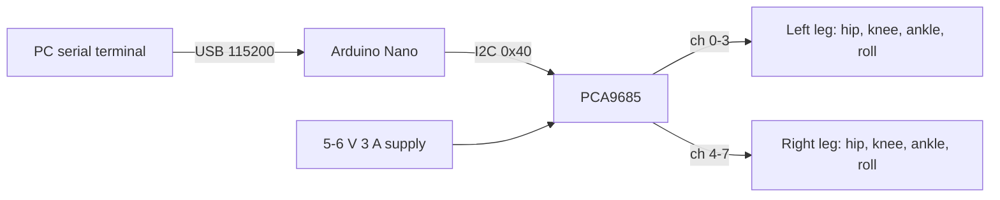
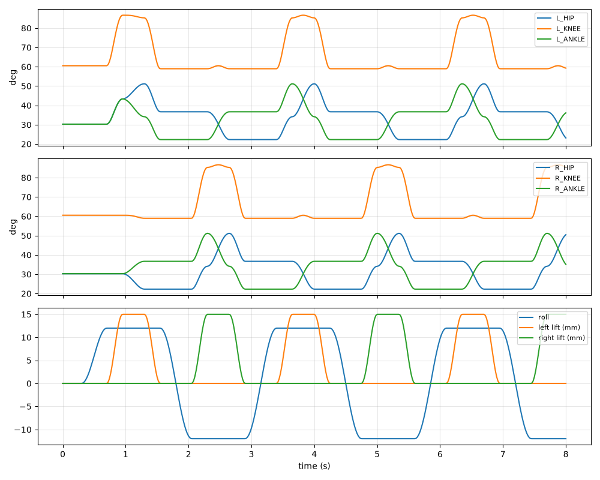
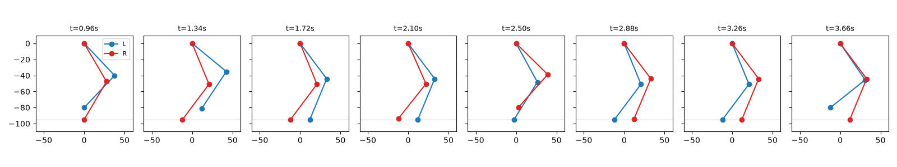

# biped-robot

An 8 servo biped that walks with a simple lean-lift-swing gait. An Arduino
Nano drives the servos through a PCA9685 board. Foot positions are defined in
millimetres and turned into joint angles with 2-link inverse kinematics, and
the motion between key poses is eased so the servos don't jerk. You control
it with short text commands over USB serial.

This is a rebuilt and cleaned up version of my B.Tech project at Anurag
Group of Institutions (now Anurag University). The original gait was a table
of hand-tuned servo angles. Here the gait is written as foot positions and
IK does the rest, which made it much easier to change step length and
height. The IK, gait player, servo mapping and command parser are plain C
with unit tests on the PC, and there is a script to plot the gait. I don't
have photos of the original robot, so none are included.

## Block diagram



Inside the firmware, every 20 ms:

```
gait table (foot x/z + roll) -> gait player (ease between keys)
    -> ik_leg() for each leg -> joint angles
    -> calibration (center, direction, limits) -> pulse us -> PCA9685 ticks
```

## Hardware

- Arduino Nano (ATmega328P)
- PCA9685 16-channel PWM board
- 8 x MG90S metal gear micro servos
- Servo brackets / 3D printed leg parts, thigh and shin 55 mm between axes
- 5-6 V supply, 3 A or more, for the servos (not from the Nano)

DOF per leg: hip pitch, knee, ankle pitch, ankle roll.

## Wiring

| From         | To            | Notes                                   |
|--------------|---------------|-----------------------------------------|
| Nano A4      | PCA9685 SDA   |                                         |
| Nano A5      | PCA9685 SCL   |                                         |
| Nano 5V      | PCA9685 VCC   | logic only                              |
| Nano GND     | PCA9685 GND   | common ground with the servo supply     |
| Supply +     | PCA9685 V+    | servo power, add 470-1000 uF across it  |
| PCA ch 0..3  | L hip, knee, ankle, roll |                              |
| PCA ch 4..7  | R hip, knee, ankle, roll | right side mounted mirrored  |

## Leg geometry and IK

Each leg is treated as a 2-link arm in the side view. Coordinates are from the
hip joint: x forward, z down, in mm.

```
knee = acos((x^2 + z^2 - L1^2 - L2^2) / (2 L1 L2))
hip  = atan2(x, z) + atan2(L2 sin(knee), L1 + L2 cos(knee))
ankle = knee - hip          (keeps the sole parallel to the ground)
```

Standing height is 95 mm, out of 110 mm with the leg straight. Keeping the
knees bent leaves room to lift a foot without moving the hip, and keeps the
IK away from the straight-knee singularity where small changes in z need big
changes in angle.

## Gait

The walk is 11 key poses (`lib/biped_core/gait.c`). After the first three it
loops over 8 keys:

1. lean over the right foot (ankle roll +12 deg)
2. lift left foot 15 mm
3. swing left foot forward while the right foot pushes back
4. put left foot down
5. lean over the left foot
6. lift right, swing, put down, lean back right ...

Step is 24 mm (foot goes from -12 to +12 mm), one full loop is 2.7 s at
100% speed. Between keys the player uses a cosine ease, so each move starts
and ends slowly.




## Serial commands

115200 baud, one command per line:

| Command            | What it does                                     |
|--------------------|--------------------------------------------------|
| `walk`             | start walking                                    |
| `stop` / `home`    | ease back to the standing pose                   |
| `speed <25-200>`   | gait speed in percent                            |
| `j <servo> <deg>`  | move one joint (only when stopped)               |
| `trim <servo> <us>`| change a servo's center pulse                    |
| `cal`              | print center pulses and current angles           |

Servo numbers: 0 L_HIP, 1 L_KNEE, 2 L_ANKLE, 3 L_ROLL, 4 R_HIP, 5 R_KNEE,
6 R_ANKLE, 7 R_ROLL. Replies are `ok` or `err <reason>`.

## Build and flash

```
pip install platformio
pio run
pio run -t upload
pio device monitor -b 115200
```

Compile output (no board connected):

```
RAM:   [=====     ]  54.8% (used 1123 bytes from 2048 bytes)
Flash: [====      ]  43.9% (used 13492 bytes from 30720 bytes)
```

Before the first walk, do the calibration in
[docs/calibration.md](docs/calibration.md).

## Tests and plots

```
$ make test
...
./build/run_tests
1015 checks, 0 failed
```

The check count is high because some tests check every 20 ms step of a 20 s
walk. They cover:

- IK against known poses, and IK -> FK round trip on a grid of points
- out of reach targets are rejected
- every key pose is reachable and inside the joint limits
- the robot never has both feet off the ground
- a foot only lifts while the body is leaning over the other foot
- no joint moves more than 4 deg in one 20 ms frame
- `stop` mid-step returns to the home pose
- servo pulse math, limits, mirrored servos and PCA9685 tick conversion
- command parser, including bad input

```
$ pip install -r requirements.txt
$ python3 -m pytest -q tests
.....                                                                    [100%]
5 passed in 0.96s
```

The pytest side runs `build/gait_dump` (same C code as the firmware), checks
it against a Python copy of the IK, and checks the plot script runs.

To make the plots yourself:

```
$ make plot
./build/gait_dump 8000 20 > build/gait.csv
python3 tools/plot_gait.py build/gait.csv
plotted 401 samples -> build/gait_joints.png, gait_legs.png
```

Sample of the CSV:

```
t_ms,lx,lz,rx,rz,roll,L_HIP,L_KNEE,L_ANKLE,L_ROLL,R_HIP,R_KNEE,R_ANKLE,R_ROLL
0,0.00,95.00,0.00,95.00,0.00,30.27,60.55,30.27,0.00,30.27,60.55,30.27,0.00
960,0.02,80.00,-0.02,95.00,12.00,43.36,86.68,43.32,12.00,30.26,60.55,30.29,12.00
```

## Known limitations

- Open loop. There is no IMU, so the gait only works on a flat table and
  the lean angle has to be tuned by hand for the weight of the robot.
- No hip roll or hip yaw, so it can only walk straight. Turning would need
  at least hip yaw servos.
- Trims set with `trim` are lost on reset. They have to be copied into
  `servo.c` by hand.
- After `j` commands, `walk` starts from the gait's idea of where the feet
  are, not where you moved them, so the first move can jump.
- The gait table is in RAM on the AVR (that is most of the 54% RAM use).
- Only the C logic is tested. Servo behaviour, power and balance need the
  real robot.

## Things I'd do differently

- Add an MPU6050 and use the body tilt to adjust the lean instead of a
  fixed 12 deg.
- Save trims to EEPROM.
- Move the gait table to PROGMEM, or generate key poses from step length
  and height at runtime.
- Use servos with position feedback, or at least read the current draw per
  leg, to detect when a foot actually touches down.
- Use an ESP32 instead of the Nano. Floating point IK for two legs every
  20 ms is fine on the Nano, but there is not much headroom left.

## License

MIT
